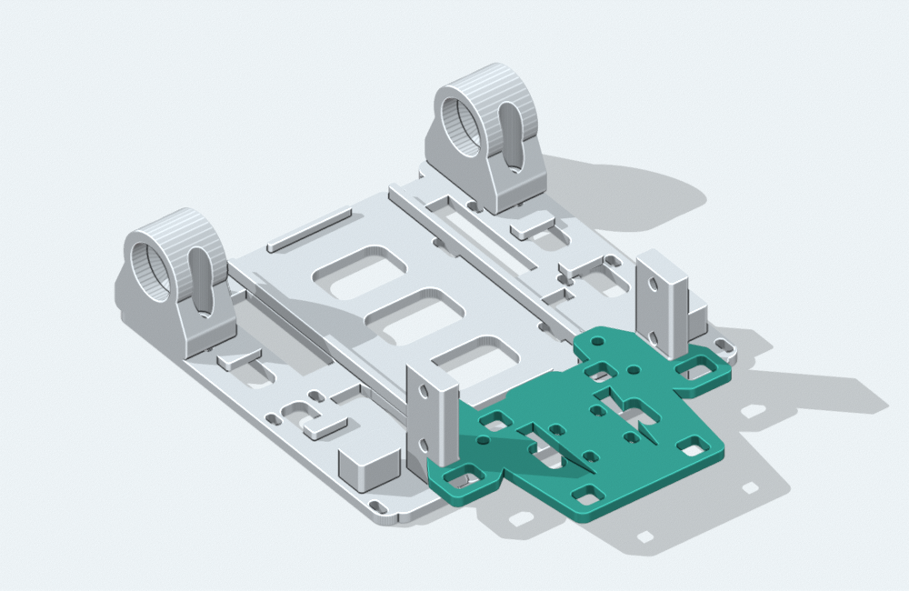
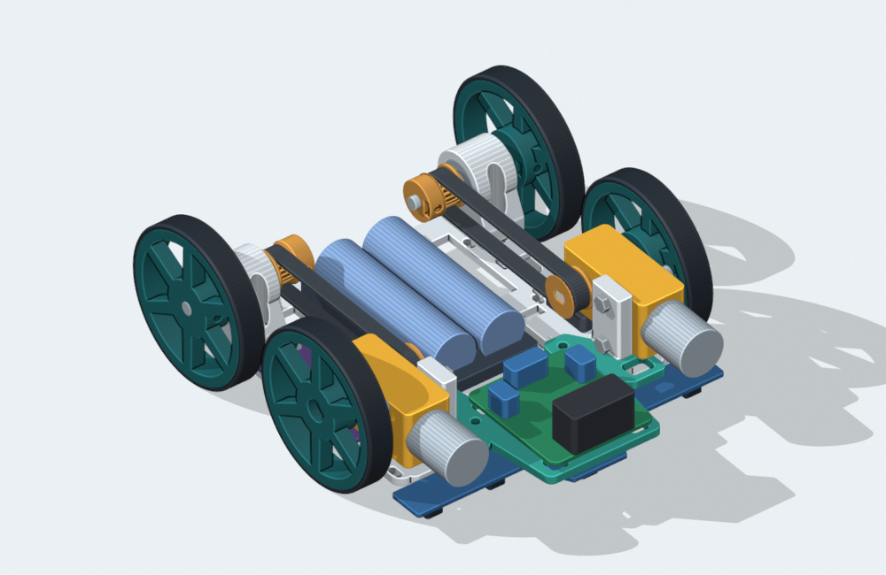

# MoseRase

Компактне шасі робота, що їде по лінії, з чотирма колесами у два ряди. Два мотор-редуктори TT 48:1 стоять біля передньої осі. Кожен крутить переднє колесо і через зубчастий ремінь 1:1 передає обертання задньому колесу свого боку. Лівим і правим бортами керує ESP32 через L298 або DRV8833.

[Завантажити комплект ZIP](Myshachi-perehony-L298-DRV8833.zip) · [Креслення та інструкція PDF](docs/Kreslennia-MoseRase-v3.pdf) · [Відкрити модель OpenSCAD](MyshachiPerehony.scad)

| Гола рама | Повна збірка з L298 |
| --- | --- |
|  |  |

Розміри основної деталі приблизно **114 × 115 мм**. Зі всіма деталями орієнтовно **164 × 144 мм**, залежно від плат і посадки BFD. Номінальна база **70 мм** і колеса **Ø60 × 10 мм** дають 10 мм між шинами на одному боці. Дно ванночки під типовий тримач **2×18650, 43 × 76 мм** має кліренс 7 мм. Вирізи зменшують об’єм нижньої пластини на 17% за тієї ж зовнішньої геометрії й товщини. Диски мають спиці, а BFD і драйвер монтуються на спільний передній модуль.

## Варіант без ременів

Два передні колеса ведучі, два задні вільно обертаються на окремих півосях. [Модель та інструкція](beltless/README.md) · [ZIP для друку](MoseRase-Beltless.zip)

## Додаткова рама під турбіни

Окремий комплект із камерою під днищем і однією або двома турбінами 5015 під батарейною полицею. [Модель та інструкція](fan-kit/README.md) · [ZIP для друку](MoseRase-FanKit.zip)

## Що друкувати

| Файл | Кількість | Призначення |
| --- | ---: | --- |
| [01-rama.stl](stl/01-rama.stl) | 1 | Основна рама з ванночкою й кріпленнями TT |
| [02-nis-BFD-L298-DRV8833.stl](stl/02-nis-BFD-L298-DRV8833.stl) | 1 | Передній модуль для BFD і драйвера |
| [03-opora-vala-625.stl](stl/03-opora-vala-625.stl) | 2 | Регульовані тримачі задніх півосей |
| [04-dysk-TT.stl](stl/04-dysk-TT.stl) | 2 | Передні диски на подвійний D-профіль TT |
| [05-dysk-val-5mm.stl](stl/05-dysk-val-5mm.stl) | 2 | Задні диски на сталевий вал Ø5 мм з лискою |
| [06-shyna-TPU.stl](stl/06-shyna-TPU.stl) | 4 | Шини Ø60 × 10 мм |
| [07-shkiv-TT-GT2.stl](stl/07-shkiv-TT-GT2.stl) | 2 | Передні 20-зубі шківи TT |
| [08-shkiv-val-5mm-GT2.stl](stl/08-shkiv-val-5mm-GT2.stl) | 2 | Задні 20-зубі шківи під вал Ø5 мм з лискою |
| [09-shablon-posadky.stl](stl/09-shablon-posadky.stl) | 1 | Пробні посадки під два типи валів |

STL у мм. Для рами почніть із PETG, шару 0,2 мм і чотирьох периметрів. Для шківів використайте PETG або PA та шар 0,12–0,16 мм. Шини друкуйте з TPU. Перед комплектом перевірте посадки на шаблоні й приміряйте один надрукований шків до фактичного ременя. Форма його зубців наближена, а допуски деталей TT і PCB взяті за кресленням та фото.

## Що встановити

- **З комплекту** потрібні два TT 48:1, ESP32, BFD, Makerfabs L298 або DRV8833, тримач 2×18650, два акумулятори й UBEC 5 В. Для варіанта DRV8833 на схемі також є місце під понижувач моторної шини до 6 В.
- **Для передачі** додайте два замкнені ремені **GT2/2GT 180 × 6 мм**, чотири підшипники **625 (5 × 16 × 5 мм)** та дві сталеві півосі **Ø5 × 50 мм**. На кінцях півосі в місцях посадки диска й шківа потрібна лиска глибиною 0,6 мм. Ділянки під підшипники залиште круглими. Для кожної півосі потрібні дві невеликі проставки з отвором Ø5 мм. Номінальні довжини 2,5 мм із боку шківа та 4,3 мм із боку колеса. Підганяйте довжину за фактичним люфтом і спирайте проставки на внутрішні кільця підшипників.
- **Кріплення** для двох TT потрібні чотири M3×30 зі зниженою головкою. Для носа використайте чотири M3×16. Для тримачів задніх валів почніть із чотирьох M3×14 з низькими головками та гайками й шайбами під рамою. Верхні кишені відкривають доступ до головок. До задніх шківів потрібні два притискні M3×6, до задніх дисків два M3×8 та по одній гайці M3 в кожній кишені. Притискні гвинти сідають на лиски. На TT використовуйте осьові фіксатори із шайбами після звірки заводських отворів.

1. Закріпіть TT корпусами вперед. Поставте передні колеса зовні моторів, передні шківи на внутрішніх виходах.
2. Посадіть по два 625 у кожну задню опору. Встановіть сталеві півосі, проставки, шківи та задні колеса. Опори можна зсувати приблизно на ±2 мм уздовж рами. Надягніть ремені, вирівняйте півосі й затягніть кріплення після підбору натягу. Колеса мають вільно крутитися від руки.
3. Закріпіть батареї в центрі, ESP32 праворуч, UBEC ліворуч. Проведіть проводи осторонь ременів, особливо біля плат лівого борту. USB ESP32 повернуто назад.
4. Додайте передній модуль. BFD встановлюється знизу через ізоляційні проставки, L298 або DRV8833 зверху. Після складання відрегулюйте **3–4 мм під оптикою BFD** на рівній трасі.

`MyshachiPerehony.scad` та `Drive.scad` мають лежати разом. У списку `part` виберіть `bare` для голої рами, `assembly_l298` або `assembly_drv8833` для перегляду повної збірки. Для повторного STL-експорту виберіть одну друковану деталь та натисніть F6.
