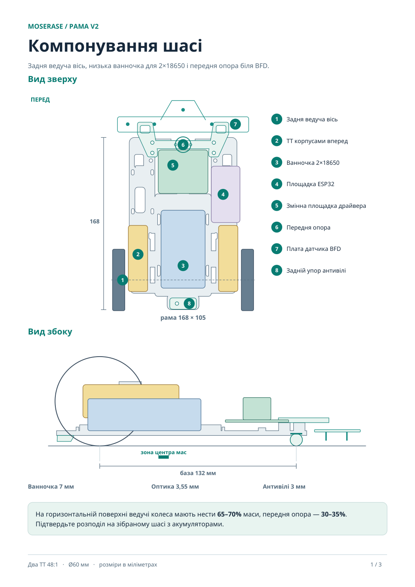

# MoseRase

Рама для робота, що їде по лінії. Два TT 48:1 крутять по одному колесу Ø60 мм. Ведуча вісь розташована біля заднього краю, корпуси моторів спрямовані вперед. Передня опора може бути друкованим ковзуном або Pololu #952.

- [Завантажити ZIP зі STL, OpenSCAD і кресленням](Myshachi-perehony-L298-DRV8833.zip)
- [PDF зі схемами, складанням та шаблоном 1:1](docs/Kreslennia-ta-zbyrannia.pdf)
- [Параметрична модель OpenSCAD](MyshachiPerehony.scad)

## Деталі для друку

| Деталь | Файл і кількість |
| --- | --- |
| Рама 168 × 105 мм із батарейною ванночкою та стійками TT | [01-rama.stl](stl/01-rama.stl), 1 шт. |
| Ніс під BFD і передню опору | [02-nis-BFD.stl](stl/02-nis-BFD.stl), 1 шт. |
| Площадка Makerfabs L298 | [03-ploshchadka-L298.stl](stl/03-ploshchadka-L298.stl), 1 шт. на вибір |
| Площадка DRV8833 | [04-ploshchadka-DRV8833.stl](stl/04-ploshchadka-DRV8833.stl), 1 шт. на вибір |
| Передній ковзун | [05-kovzun.stl](stl/05-kovzun.stl), 1 шт. за потреби |
| Задній упор | [06-zadnii-upor.stl](stl/06-zadnii-upor.stl), 1 шт. |

STL у міліметрах. Компоненти лежать пласкою стороною на столі в експортованих файлах. У OpenSCAD виберіть деталь у `part`, натисніть F6 і експортуйте STL. Варіанти `assembly_l298` та `assembly_drv8833` призначені для перегляду складання.

## Складання

1. Встановіть TT корпусами вперед. Для кожного редуктора використайте два наскрізні М3×30 зі зниженою головкою з боку колеса та гайками з внутрішнього боку. Перевірте крок штатних отворів 17,3 мм і зазор від головок до колеса. Пази під стяжки дають додатковий притиск.
2. Покладіть тримач 2×18650 габаритом до 43 × 76 мм прямо у ванночку. Кліренс її дна з Ø60 мм становить 7 мм. Фіксуйте тримач двома ремінцями після зважування.
3. Прикрутіть площадку драйвера впритул до рами. Два кріплення лежать за межами PCB. Для L298 потрібні низькі ізоляційні стійки приблизно 2,5 мм і шайби під пази. Геометрію отворів L298 і BFD звірте з шаблоном 1:1.
4. Поставте ніс на чотири М3×16. Передня точка контакту розташована за 132 мм від ведучої осі. Для Pololu #952 початкова товщина проставки 2,15 мм. Для друкованого ковзуна передбачена гладка накладка 0,4 мм. Виставте 3–4 мм від оптики BFD до траси на зібраному роботі з батареями.
5. Закріпіть задній упор двома потайними М3. Його розрахунковий зазор до траси 3 мм. Прокрутіть колеса вручну та перевірте, що упор і головки гвинтів не чіпляють шини.

## Розважування

Цільова частка на передній опорі становить 30–35%, а на двох ведучих колесах разом 65–70%. Для бази 132 мм це означає центр мас на 39,6–46,2 мм попереду ведучої осі.

Розрахунок з оціненими масами деталей та центром тримача на 30 мм попереду осі дає орієнтовно 33–34% спереду з L298 і 31% з DRV8833. Висота центра мас у моделі близько 21 мм. Тримач можна зсувати на ділянці +24…+44 мм від осі. Його зміщення вперед на 5 мм у цій оцінці додає приблизно 1,3–1,4 відсоткового пункта спереду.

Поставте обидва ведучі колеса та передню опору на опори однакової висоти. Зважте передню опору і ведучу пару. Поділіть показ спереду на суму показів. Зважте ще раз після переміщення тримача та збережіть отримане положення.

Для розгону вперед частка навантаження спереду змінюється на `−(a/g)·h/L`, де `h` — висота центра мас, `L` — база. При гальмуванні навантаження переходить уперед. За `h≈21 мм` і прискорення або гальмування `0,5g` зміна становить приблизно 8 відсоткових пунктів. Це оцінка для рівної траси, а геометрія PCB, посадка та фактичний розподіл ваги потребують перевірки на прототипі.

Для DRV8833 використовуйте моторну шину 6,0 В із запасом струму на одночасний старт двох TT. [Характеристики TT](https://myproject.com.ua/dvigun-z-reduktorom-148-dc3v-6v-ua.html) · [Дані TI для DRV8833](https://www.ti.com/lit/ds/symlink/drv8833.pdf)
