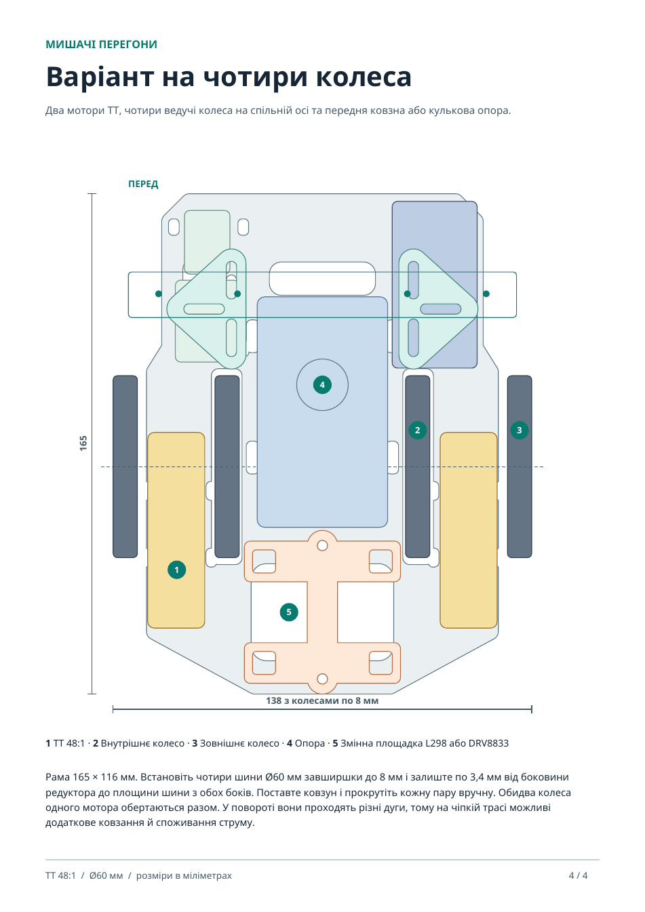

# MoseRase

Рами для робота, що їде по лінії. Проєкт розрахований на два мотор-редуктори TT 48:1, ESP32 і датчик лінії BFD. На кожну раму можна встановити площадку L298 або DRV8833.

- [Завантажити весь комплект ZIP](Myshachi-perehony-L298-DRV8833.zip)
- [Креслення PDF, складання та шаблон 1:1](docs/Kreslennia-ta-zbyrannia.pdf)
- [Редагована модель OpenSCAD](MyshachiPerehony.scad)

## Деталі для друку

| Деталь | Файл і кількість |
| --- | --- |
| Рама 147 × 106 мм під два колеса Ø60 мм | [01-rama.stl](stl/01-rama.stl), 1 шт. |
| Рама 165 × 116 мм під чотири співвісні колеса Ø60 мм | [06-rama-4-spivvisni-kolesa.stl](stl/06-rama-4-spivvisni-kolesa.stl), 1 шт. |
| Тримач датчика | [02-trymach-datchyka-x2.stl](stl/02-trymach-datchyka-x2.stl), 2 шт. |
| Площадка для Makerfabs L298 | [03-ploshchadka-L298.stl](stl/03-ploshchadka-L298.stl), 1 шт. за вибором |
| Площадка для DRV8833 | [04-ploshchadka-DRV8833.stl](stl/04-ploshchadka-DRV8833.stl), 1 шт. за вибором |
| Передній ковзун | [05-kovzun.stl](stl/05-kovzun.stl), 1 шт. |

Для чотириколісної рами підійдуть шини завширшки до 8 мм. Кожен мотор крутить внутрішнє й зовнішнє колесо свого боку. Усі чотири стоять в один ряд. Передній ковзун або кулькова опора утримує датчик над трасою.

STL розраховані в міліметрах. До друку роздрукуйте сторінку 3 PDF у масштабі 100% і приміряйте плати. Положення отворів плати L298 і датчика оцінено за фото. В OpenSCAD можна змінити міжосьові розміри L298, вибрати варіант рами в `wheel_setup` та окрему деталь у `part`.

## Живлення для заїзду

Для DRV8833 закладено стабілізовану моторну шину 6,0 В із запасом струму на одночасний старт обох моторів. Два звичайні 18650 у 2S після заряджання дають до 8,4 В. При заклинюванні вала 8,6 В дали б близько вдвічі більше нагрівання обмотки, ніж 6 В, якщо опір однаковий. Перед гонкою варто прогнати повні п’ять хвилин у гоночному темпі й перевірити нагрів та стабільність тяги. [Характеристики TT](https://myproject.com.ua/dvigun-z-reduktorom-148-dc3v-6v-ua.html) · [Дані TI для DRV8833](https://www.ti.com/lit/ds/symlink/drv8833.pdf)
