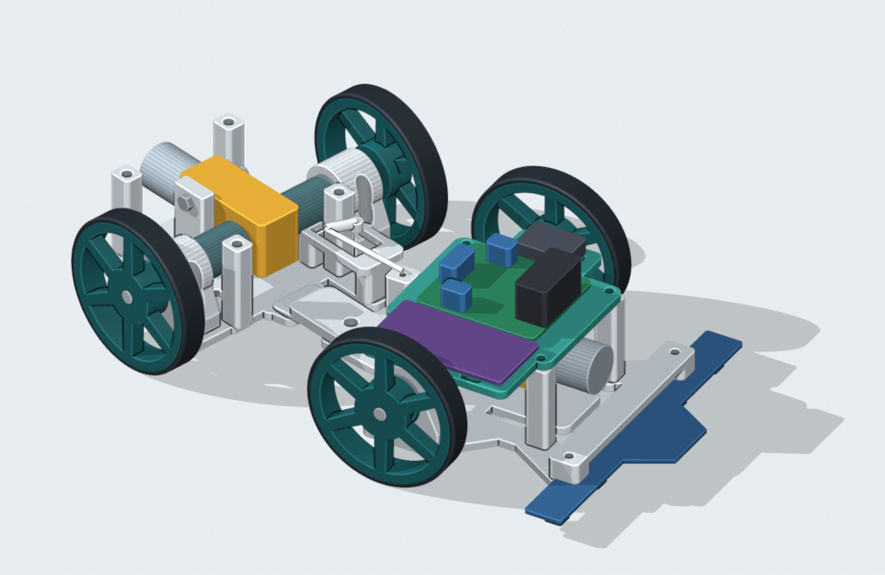

# MoseRase 4×4 із двома ТТ і шарнірним кермуванням

Один двобічний ТТ 48:1 стоїть поперек передньої осі й обертає обидва передні колеса. Другий так само приводить обидва задні. На кожному виході ТТ муфта передає момент на окрему сталеву піввісь. Вісім підшипників 625 приймають навантаження від коліс. Колісна база в прямому положенні — 96 мм, колія — близько 115 мм, шини — Ø60 × 10 мм.

Поворот задає мікросервопривід MG90S або сумісний за розмірами. Тяга повертає передню секцію разом із мотором, колесами та BFD навколо вертикального шарніра. CAD показує поворот до ±22°. Оскільки ТТ задає однакову швидкість обом колесам своєї осі, внутрішні колеса на повороті ковзатимуть. Для першого заїзду варто виставити менший діапазон і перевірити його на трасі.

## Друк

| Деталь | Кількість |
| --- | ---: |
| [Передня рама](stl/01-perednia-rama.stl) | 1 |
| [Задня рама](stl/02-zadnia-rama.stl) | 1 |
| [Полиця тримача 2×18650](stl/03-polychka-18650.stl) | 1 |
| [Полиця ESP32 та драйвера](stl/04-panel-elektroniky.stl) | 1 |
| [Муфта ТТ → Ø5 мм](stl/05-mufta-TT-5mm.stl) | 4 |
| [Опора під два 625](../stl/03-opora-vala-625.stl) | 4 |
| [Диск на вал Ø5 мм](../stl/05-dysk-val-5mm.stl) | 4 |
| [Шина TPU](../stl/06-shyna-TPU.stl) | 4 |

Усі STL у міліметрах. Для рам підійдуть PETG і 4 периметри. У слайсері додайте підтримки під виступом заднього шарніра, полицею серво й передньою перемичкою BFD. Спочатку надрукуйте одну муфту і [шаблон посадки](../stl/09-shablon-posadky.stl). Звірте обидва виходи своїх ТТ, геометрію їхніх монтажних отворів і положення отворів плати BFD. Параметри `tt_fit` і `shaft_fit` можна змінити в OpenSCAD.

## Складання

1. Закріпіть по одному ТТ на кожній секції двома гвинтами M3×30 з низькою головкою. Корпуси моторів спрямовані від шарніра. Вставте по два 625 в опору й закріпіть кожну опору двома M3×14 із низькими головками, шайбами й гайками. Перевірте співвісність усіх виходів до затягування гвинтів.
2. Використайте чотири сталеві півосі Ø5 × 40 мм. На кінцях під муфту й під диск потрібні лиски глибиною 0,6 мм. Під підшипниками вал залиште круглим. У муфту та диск вставте гайки M3 і закріпіть їх притискними гвинтами на лисках. Почніть із M3×6 для муфт і M3×8 для дисків. Між муфтою й внутрішнім підшипником використайте проставку близько 1,5 мм, між зовнішнім підшипником і диском — близько 4,3 мм. Підберіть їх за фактичним осьовим люфтом так, щоб проставки торкалися тільки внутрішніх кілець.
3. З'єднайте секції гладкою шийкою Ø5 мм, шайбами й самоконтрівною гайкою. У моделі між площадками 1 мм під тонку шайбу. Затягніть до мінімального люфту, залишивши шарнір вільним. Перевірте, що нижній кріпіж має зазор до траси.
4. Установіть мікросервопривід, виставте нейтраль із прямою рамою. Модель використовує отвір качалки за 11 мм від центра й регульовану тягу з 37 мм між центрами шарнірів. Використайте шарові наконечники. Підженіть висоту тяги проставкою біля передньої стійки й перевірте крайні положення вручну перед подачею живлення.
5. Прикрутіть полиці до стійок термовставками M3 і гвинтами M3×8. Закріпіть тримач 2×18650, ESP32 і UBEC стяжками. Драйвер L298 або DRV8833 керує моторами окремо. Для DRV8833 передбачені прорізи під стяжку. Установіть BFD знизу на проставки, виставте зазор 3–4 мм і проведіть дроти через шарнір із петлею для повороту.
6. Під час першого тесту підніміть усі колеса. Перевірте, що обидві осі штовхають машину вперед за однакової команди. Полярність однієї пари дротів може потребувати перестановки, оскільки мотори розвернуті. Перевірте напрямок сервопривода й обмежте його хід у прошивці. Живіть серво від стабілізованих 5 В із запасом на піковий струм і спільною землею з ESP32.

У [AxleDrive.scad](../AxleDrive.scad) є повна збірка, голі рами і режими експорту деталей. Параметр `steering_angle` показує поворот, `driver` перемикає L298 і DRV8833. `MyshachiPerehony.scad` та `Drive.scad` мають лежати поруч. Це CAD-прототип. Почніть з пробної посадки муфти та перевірки ходу серво на зібраному шарнірі.
