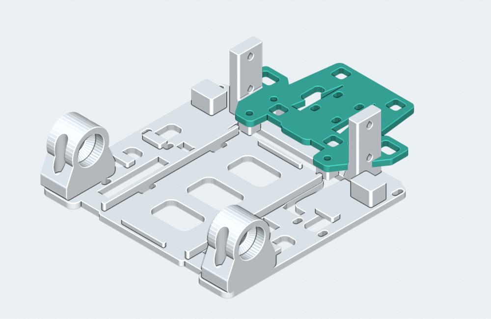
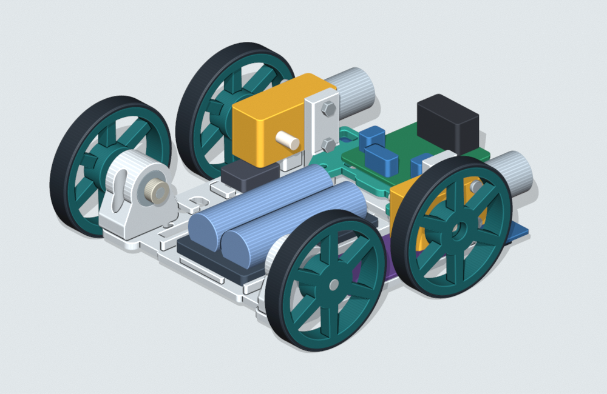

# MoseRase без ременів

[← Каталог моделей](../README.md) · [Завантажити комплект ZIP](https://raw.githubusercontent.com/andriilyspp2025-cmd/MoseRase/main/MoseRase-Beltless.zip)

Два TT 48:1 окремо приводять передні колеса. Два задні колеса вільно обертаються на незалежних сталевих півосях. Колісна база — 70 мм, шини — Ø60 × 10 мм, кліренс під рамою — 7 мм. Ніс під датчик BFD і монтаж електроніки взяті з v3. Задні отвори в новій рамі фіксують півосі на номінальній базі.

| Рама з носом і опорами | Повна збірка з L298 |
| --- | --- |
|  |  |

## Друк і деталі

| STL | Кількість |
| --- | ---: |
| [Рама з фіксованими задніми опорами](stl/01-rama-bez-remeniv.stl) | 1 |
| [Ніс під BFD і драйвер](../stl/02-nis-BFD-L298-DRV8833.stl) | 1 |
| [Опора під 625](../stl/03-opora-vala-625.stl) | 2 |
| [Передній диск TT](../stl/04-dysk-TT.stl) | 2 |
| [Задній диск Ø5 мм](../stl/05-dysk-val-5mm.stl) | 2 |
| [Шина TPU](../stl/06-shyna-TPU.stl) | 4 |

Для рами підійде PETG, шар 0,2 мм, 4 периметри. Перед друком дисків перевірте посадку на [шаблоні TT і Ø5 мм](../stl/09-shablon-posadky.stl). Для пробних заїздів можна використати готову раму v3, виставивши її задні опори на 70 мм від передньої осі.

## Збірка

1. Прикрутіть два TT корпусами вперед і посадіть передні диски на зовнішні кінці валів. Перевірте заводські отвори TT і встановіть осьові фіксатори з шайбами. Кріплення носа, моторів, акумуляторів та електроніки показане в [інструкції v3](../docs/Kreslennia-MoseRase-v3.pdf).
2. У кожну задню опору встановіть два підшипники 625 (5 × 16 × 5 мм). Опори закріпіть чотирма M3×14 із низькими головками, гайками й шайбами. Вставте окрему сталеву піввісь Ø5 × 36 мм на кожному боці. Під притискний гвинт заднього диска зробіть лиску 0,6 мм на зовнішньому кінці півосі. Ділянки під підшипники мають лишитись круглими.
3. З внутрішнього боку встановіть стопорне кільце Ø5 мм із гвинтом і тонку проставку, номінально 1 мм. З боку колеса встановіть проставку 4,3 мм і диск із гайкою та притискним гвинтом M3×8. Підберіть товщину проставок за фактичним люфтом. Вони мають спиратися на внутрішні кільця підшипників. Після затягування задні колеса повинні вільно обертатися.
4. Установіть BFD і виставте 3–4 мм між оптикою та трасою. Перевірте, що всі чотири колеса торкаються рівної поверхні, а задні колеса проходять повз раму, шайби й гайки.

У [Beltless.scad](../Beltless.scad) виберіть `assembled` для збірки, `bare` для рами з носом і опорами або `chassis` для експорту STL рами. Параметр `driver` перемикає L298 і DRV8833. Зберігайте поряд `MyshachiPerehony.scad` та `Drive.scad`.
