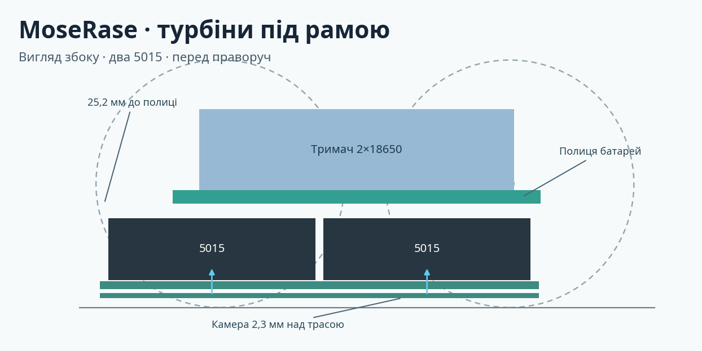

# MoseRase v3 із турбінами під рамою

[← Каталог моделей](../README.md) · [Завантажити комплект ZIP](https://raw.githubusercontent.com/andriilyspp2025-cmd/MoseRase/main/MoseRase-FanKit.zip)

Один або два відцентрові вентилятори **5015 (50 × 50 × 15 мм, 5 В)** стоять під піднятою батарейною полицею. Кожен забирає повітря з камери під днищем через вхід, спрямований до траси. Вихлоп виходить через бічний патрубок 5015. Для вихлопу вгору потрібен окремий вигин, підібраний під патрубок конкретного вентилятора.

| Елемент | Висота від рівної траси |
| --- | ---: |
| Нижня кромка жорсткої камери | 2,3 мм |
| Корпус 5015 | 6,7–21,7 мм |
| Нижній і верхній боки батарейної полиці | 25,2–28,4 мм |
| Робочий зазор датчика BFD | 3–4 мм |

## Модель і друк

Відкрийте [FanKit.scad](../FanKit.scad) разом із `MyshachiPerehony.scad` та `Drive.scad` в одній папці. В OpenSCAD виберіть `fan_count` і `driver`. Параметр `fan_part` має режими `assembled` для повної збірки, `bare` для рами з полицею й камерою, а також `chassis`, `battery_deck` і `pan` для експорту окремих STL. У готових STL отвір під вхід має Ø28 мм. Після заміру входу можна відрегулювати `inlet_d` у межах 26–34 мм.

| STL | Кількість |
| --- | ---: |
| [Піднята рама](stl/01-pidniata-rama.stl) | 1 |
| [Полиця для тримача 2×18650](stl/02-polychka-18650.stl) | 1 |
| [Камера на 1×5015](stl/03-nyzhnia-kamera-1x5015.stl) або [камера на 2×5015](stl/03-nyzhnia-kamera-2x5015.stl) | 1 на вибір |

Ніс із BFD, кріплення драйвера і деталі чотириколісної ходової беруться з [MoseRase v3](../docs/Kreslennia-MoseRase-v3.pdf). Нижня камера в STL лежить дахом на столі. Для жорстких деталей підійде PETG із шаром 0,2 мм і 3–4 периметрами.

## Збірка

1. Підготуйте 4 низькі гайки M3 і 4 потайні гвинти M3×8 для камери. Між кожним вушком камери і рамою покладіть прокладку приблизно 0,7 мм. Перевірте, що головки втоплені знизу, а гайки затягнуті з боку рами.
2. Поки полицю знято, поставте 5015 плоским входом донизу на тонке кільцеве ущільнення навколо каналу. Стягніть корпус через зовнішні вушка камери. Звірте фактичні габарити корпуса, положення отвору та напрямок вихлопу. Закріпіть проводку і кінці стяжок поза ременями.
3. Встановіть 4 термовставки M3 у верхні опори рами. Отвори під вставки мають Ø4,15 мм. Звірте розмір зі своїми вставками і перевірте посадку на пробному друці. Прикрутіть полицю гвинтами M3×8 і притягніть тримач 2×18650 стяжкою крізь прорізи. Модель показує тримач до 43 × 76 × 24 мм.
4. Перевірте обертання всіх коліс і роботу ременів. Спочатку проїдьте трасу з жорсткою камерою. Якщо потрібна спідниця, зробіть її з тонкого TPU або м’якої стрічки та залиште 1–2 мм до поверхні. Перевірте кліренс на стиках покриття.
5. Живіть 5-вольтові 5015 від стабілізованих 5 В. Перевірте, чи витримує перетворювач сумарний струм обох турбін і пусковий струм.

Розміри перевірені в CAD за габаритними моделями. Перед друком звірте свою партію 5015, а на трасі порівняйте час кола з вимкненими й увімкненими вентиляторами.
