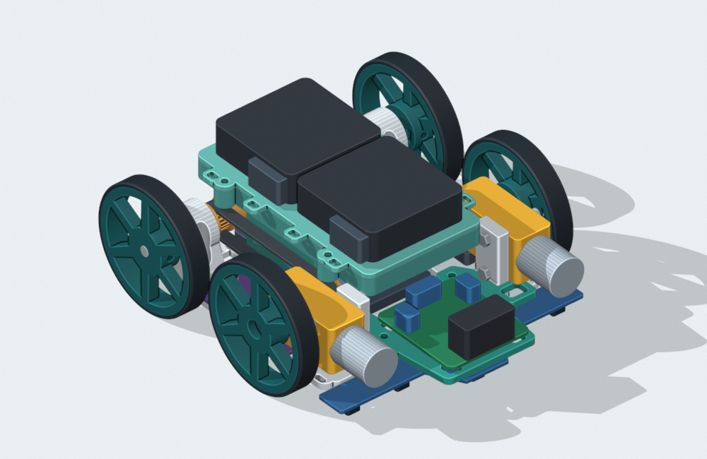

# Знімний модуль притиску для MoseRase v3

Модель розрахована на один або два відцентрові вентилятори **5015, 50 × 50 × 15 мм, 5 В**. Повітря йде з-під машини через нижню камеру, два вертикальні канали й верхній колектор до вхідних отворів вентиляторів. Бічний вихід кожного вентилятора має виходити у відкритий простір.

Відкрийте `FanKit.scad` поруч із `MyshachiPerehony.scad` та `Drive.scad`. У Customizer виберіть `fan_count` і `driver`. Положення `assembled` показує приклад повної збірки, а `bare` — друковане шасі зі змонтованим повітряним трактом. `inlet_d` задає діаметр отвору кришки від 26 до 34 мм, базові STL мають Ø28 мм.

## Що друкувати

| STL | Кількість |
| --- | ---: |
| [01-rama-z-kanalamy](stl/01-rama-z-kanalamy.stl) | 1 |
| [02-nyzhnia-kamera](stl/02-nyzhnia-kamera.stl) | 1 |
| [03-stiika-kanal-x2](stl/03-stiika-kanal-x2.stl) | 2 |
| [04-kolektor-1](stl/04-kolektor-1.stl) і [05-kryshka-1x5015](stl/05-kryshka-1x5015.stl) | По 1 на версію з однією турбіною |
| [04-kolektor-2](stl/04-kolektor-2.stl) і [05-kryshka-2x5015](stl/05-kryshka-2x5015.stl) | По 1 на версію з двома турбінами |

Використайте **раму з каналами**. Решта деталей ходової та кріплення BFD беруться з MoseRase v3. Нижня камера в STL лежить дахом на столі. Для друкованих деталей підійде PETG із шаром 0,2 мм та 3–4 периметрами. Для гнучкої спідниці використайте тонкий TPU або м’яку стрічку.

## Складання

1. Встановіть батарейний тримач до монтажу верхнього колектора. Тунель розрахований на тримач із габаритами до **43 × 76 × 24 мм**. Виведіть його дроти через торець, осторонь ременів.
2. Сумістіть входи нижньої камери, отвори рами та дві стійки. Верхній колектор стоїть на стійках і перекриває батарейний відсік. Нижню камеру, раму, стійки та колектор стягніть чотирма **M3×40** зі зниженою головкою знизу й гайками всередині колектора. Підберіть тонкі прокладки навколо каналів і перевірте, що кінці гвинтів нижче кришки. Для доступу до батарейного тримача колектор і стійки можна зняти.
3. Закріпіть кришку чотирма **M3×16** через зовнішні вушка. Під кришкою прокладіть тонкий ущільнювач. Посадіть кожен 5015 входом донизу на ущільнювач і закріпіть корпус стяжками через зовнішні вушка. Геометрію входу й напрямок бічного вихлопу звірте з фактичним вентилятором.
4. Дно жорсткої камери в моделі має **2,6 мм** до рівної траси. Спідницею виставте **1–2 мм** фактичного зазору. Прокрутіть колеса й перевірте зазори до ременів і поверхні, зокрема на стиках покриття. Датчик BFD має свій зазор 3–4 мм.
5. Живіть 5-вольтові турбіни від стабілізованих 5 В. Для двох вентиляторів підсумуйте їхній струм і залиште запас на запуск. Кабелі закріпіть поза площиною ременів.

Характеристики потоку залежать від конкретного 5015 і герметичності. Перевіряйте притиск на вагах зі складеним роботом і час кола на своїй трасі.
