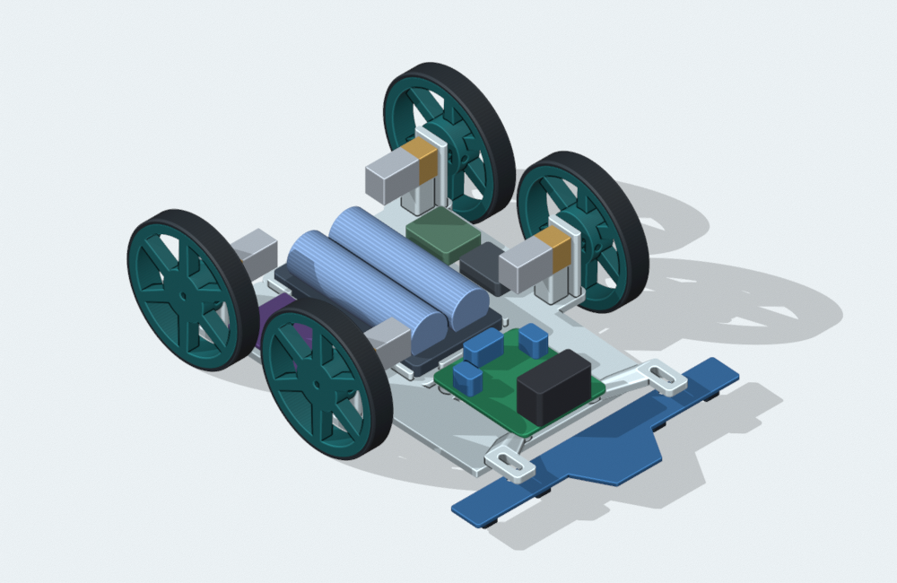
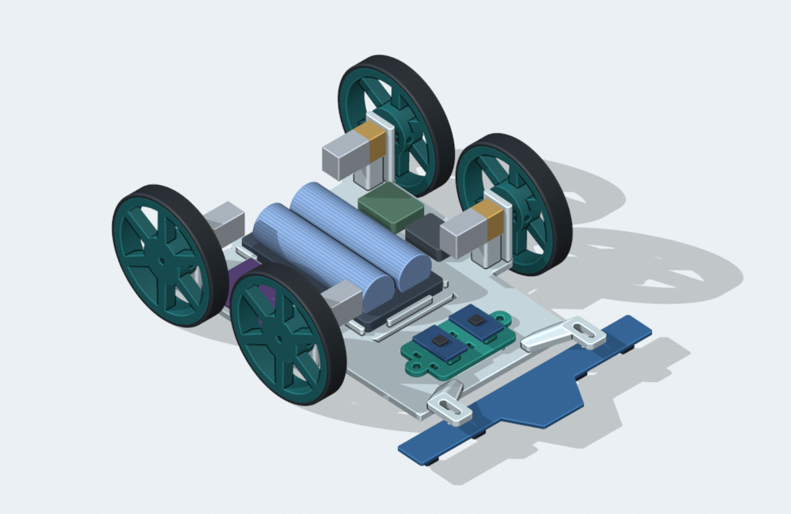

# MoseRase N20 · чотири мотори з L298 або двома DRV8833

[← Каталог моделей](../README.md) · [Завантажити комплект ZIP](https://raw.githubusercontent.com/andriilyspp2025-cmd/MoseRase/main/MoseRase-N20.zip)

Кожен GA12-N20-500RPM обертає своє колесо. Обидва варіанти мають цільну раму, базу 70 мм, колеса Ø60 × 10 мм, кліренс 7 мм і низьке центральне місце під тримач 2×18650 (43 × 76 мм). Місця праворуч і ліворуч від батарей призначені для ESP32, UBEC 5 В і, за потреби, понижувача живлення моторів. BFD стоїть спереду в поздовжніх пазах із регулюванням ±4 мм.

## Що вибрати й надрукувати

| Варіант | Деталі під раму й драйвер | Заміна драйвера |
| --- | --- | --- |
| Пряме кріплення | [Рама direct](stl/frame-direct.stl), 1 шт. | L298 знімається чотирма гвинтами. Для іншої плати можна зробити перехідник на ці самі отвори. |
| Знімна пластина | [Рама adapter](stl/frame-adapter.stl) і [пластина L298](stl/l298-adapter.stl), по 1 шт. | Два гвинти знімають пластину разом із платою. На її місце стає [пластина для двох DRV8833](stl/dual-drv8833-adapter.stl). |

Об’єм суцільної геометрії STL для прямої рами — 45,64 см³. Для змінної рами разом із пластиною — 48,53 см³, на 6,3% більше. Кріплення й підтримки в порівняння не входять. Фактичну витрату визначає слайсер. Габарити обох рам — 112 × 156 × 31 мм.

Для обох варіантів надрукуйте 4 [диски під D-вал N20](stl/wheel-N20.stl) і 4 [шини TPU](../stl/06-shyna-TPU.stl). Перед усім комплектом перевірте вал на [шаблоні](stl/shaft-gauge.stl). Для рами підійде PLA або PETG, шар 0,2 мм і 3–4 периметри. У слайсері перевірте підтримки під консолями BFD.

## Примірка та складання

1. Звірте D-вал Ø3 мм, довжину виступу 9,27 мм і два різьбові отвори M1,6 на лицьовій поверхні редуктора. У стійці передбачені обидві діагоналі, номінальний крок 6 × 9 мм. Закріпіть кожен мотор двома низькими гвинтами ззовні. Стійка має товщину 3 мм. Підберіть довжину гвинта за допустимою глибиною різьби конкретного редуктора.
2. Вставте гайку M3 в кишеню диска з внутрішнього боку, надягніть шину й посадіть диск на вал. Стопорний гвинт має притискати лиску. Почніть з установного M3×8, перевірте доступ до нього крізь спиці та зазор до головок M1,6. Чотири диски мають обертатися від руки без зачіпання.
3. Стягніть тримач акумуляторів через центральні прорізи. Поставте ESP32 праворуч, UBEC і понижувач ліворуч, зафіксуйте ізоляційними стяжками. Посадки під електроніку взято за габаритами попереднього комплекту. Звірте місця роз’ємів і виводів ваших плат.
4. Кріплення L298 розраховане на міжцентрові відстані 33,5 × 38,5 мм. Для прямого монтажу використайте чотири M3 з гайками під рамою. Для змінного монтажу спершу прикрутіть пластину двома M3 з гайками, потім плату чотирма M3 у попередньо нарізану різьбу Ø2,6 мм. Перевірте, що гвинти плати закінчуються в межах пластини, а нижній кріпіж рами має кліренс.
5. Закріпіть BFD знизу двома M3 через проставки та пази. Модель припускає 74 мм між отворами. Почніть із проставок 4,7 мм і виставте зазор 3–4 мм від оптики до траси.

## Заміна L298 на два DRV8833

Використайте раму frame-adapter і одну [пластину dual-drv8833-adapter](stl/dual-drv8833-adapter.stl). Отвори Ø3,4 мм рознесені на 46 мм під ті самі два M3. Кожне місце розраховане на компактну плату 12,7 × 20,3 мм. Під платою є 3,5 мм для виводів. Перед друком перевірте свої плати, довжину виводів і вільне місце для стяжок.

При вимкненому живленні закріпіть кожну плату окремо вузькою ізоляційною стяжкою до 2,5 мм через прорізи з обох боків. Виберіть ряд прорізів, де стяжка проходить повз мікросхему та роз’єми. Потім прикрутіть пластину до рами. Для перегляду цієї збірки в N20.scad виберіть `driver="dual_DRV8833"`; для експорту самої пластини — також `part="adapter"`.

Лівий DRV8833 обслуговує два ліві мотори, правий — два праві. На кожній платі підключіть передній мотор до AOUT1/AOUT2, задній — до BOUT1/BOUT2. Подайте моторне живлення на VM обох плат і з’єднайте GND з ESP32. Перевірте відповідність напруги моторам та допустимий струм каналів. Підключіть AIN1/AIN2 і BIN1/BIN2 до ESP32 згідно з розпіновкою обраних модулів. Для незалежної корекції всіх чотирьох коліс керуйте кожною парою входів окремо. Якщо на модулі виведено nSLEEP, він має бути у високому стані під час роботи. Для переходу з L298 також адаптуйте керування в прошивці до входів IN1/IN2 кожного моста DRV8833.

## Підключення L298

Ліві мотори підключіть паралельно до першої пари виходів L298, праві — до другої. На піднятій машині перевірте, що всі чотири колеса їдуть уперед за командою. ESP32 керує напрямком і ШІМ двох каналів. Об’єднайте землі. Живіть ESP32 через відповідний 5-вольтовий вхід від UBEC. Для BFD перевірте рівні виходів перед підключенням до GPIO 3,3 В.

Звірте номінальну напругу й струм блокування саме придбаних N20. Для 6-вольтової версії з послідовними акумуляторами 2S використовуйте відповідний понижувач моторного живлення. L298 зменшує напругу, доступну моторам. Кожен канал має витримати суму струмів двох моторів, а плата — нагрів під час заїзду. На 500 об/хв під навантаженням розраховувати лише за написом на моторі не можна.

Відкрийте [N20.scad](../N20.scad) поруч із Drive.scad і MyshachiPerehony.scad. Параметр `removable` перемикає кріплення, `part` вибирає збірку, голу раму чи окрему деталь. Параметри посадки вала та отворів дозволяють підлаштувати модель під заміри.
