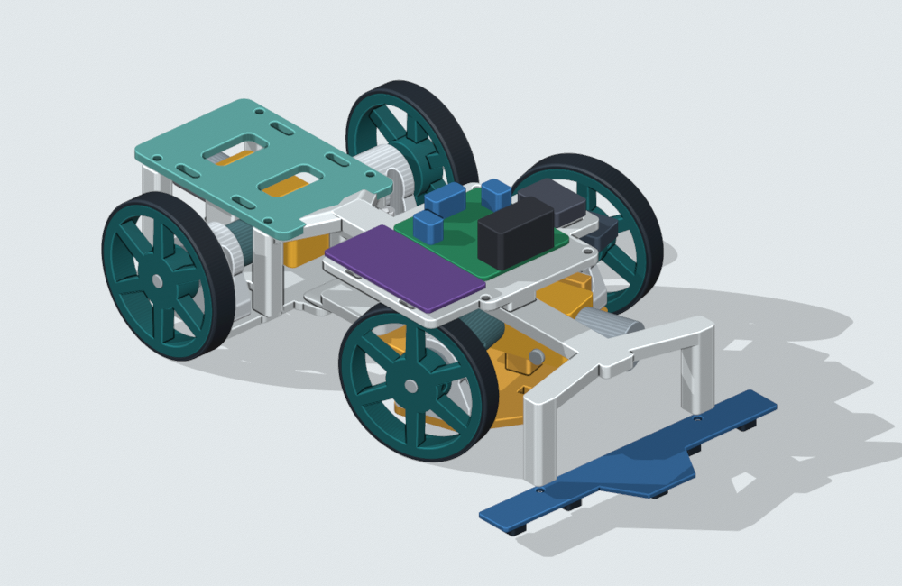

# MoseRase 4×4 із цільною рамою

[← Каталог моделей](../README.md) · [Завантажити комплект ZIP](https://raw.githubusercontent.com/andriilyspp2025-cmd/MoseRase/main/MoseRase-Rigid4WD.zip)

Одна друкована деталь зв’язує задній міст, батарейну полицю, електроніку і передні стійки датчика BFD. Передній ТТ, два його колеса та чотири підшипники стоять на поворотному візку під балкою. Задній ТТ жорстко закріплений у рамі. Усі чотири колеса ведучі, ременів немає. База по прямій — 96 мм.

## Комплект друку

| Деталь | Штук |
| --- | ---: |
| [Цільна рама](stl/chassis.stl) | 1 |
| [Візок переднього моста](stl/bogie.stl) | 1 |
| [Батарейна полиця](../axle-drive/stl/03-polychka-18650.stl) | 1 |
| [Муфта ТТ на 5 мм](../axle-drive/stl/05-mufta-TT-5mm.stl) | 4 |
| [Підшипникові опори](../stl/03-opora-vala-625.stl) | 4 |
| [Диски Ø5 мм](../stl/05-dysk-val-5mm.stl) | 4 |
| [Шини Ø60 мм](../stl/06-shyna-TPU.stl) | 4 |

Габарит деталі рами — 98 × 224 × 58,1 мм. Для столу 220 × 220 мм перевірте діагональне розміщення разом із підтримками. Почніть з PETG для рами й TPU для шин. Балка, майданчик електроніки та передні стійки потребують підтримок. Перевірте їх у слайсері перед друком. Електроніка піднята над зоною повороту коліс, батарея залишається над заднім мостом.

1. Прикрутіть задній ТТ до рами, передній — до візка. На обох мостах установіть по дві півосі Ø5 × 40 мм із муфтами, підшипниками 625 і колесами. Розміри проставок і кріплень є в [описі приводів](https://github.com/andriilyspp2025-cmd/MoseRase/blob/84969e4/axle-drive/README.md).
2. Встановіть візок під передню опору рами на вісь Ø5 мм із шайбою 1 мм між поверхнями. Закріпіть MG90S на рамі. Для першої примірки використайте плече качалки 11 мм і регульовану тягу 37 мм між центрами. Вирівняйте колеса при нейтральному положенні серво.
3. Закріпіть BFD знизу на передніх стійках у глухих отворах Ø2,6 мм під M3. Спочатку приміряйте проставки близько 4,7 мм і перевірте зазор 3–4 мм до траси. Датчик лишається на поздовжній осі рами при будь-якому куті керма.
4. Відцентруйте серво, вручну перевірте крайні положення зі встановленими проводами й обмежте хід у прошивці. Модель охоплює ±22°. Серво потребує стабілізованих 5 В і спільної землі з ESP32.

У [Rigid4WD.scad](../Rigid4WD.scad) параметр `part` перемикає збірку, голе шасі, раму й візок. Параметр `angle` повертає передній міст. Тримайте SCAD-файли з архіву в одній папці.
